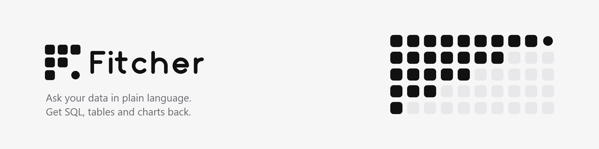
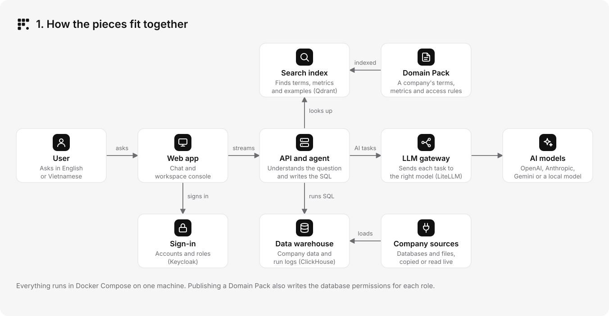
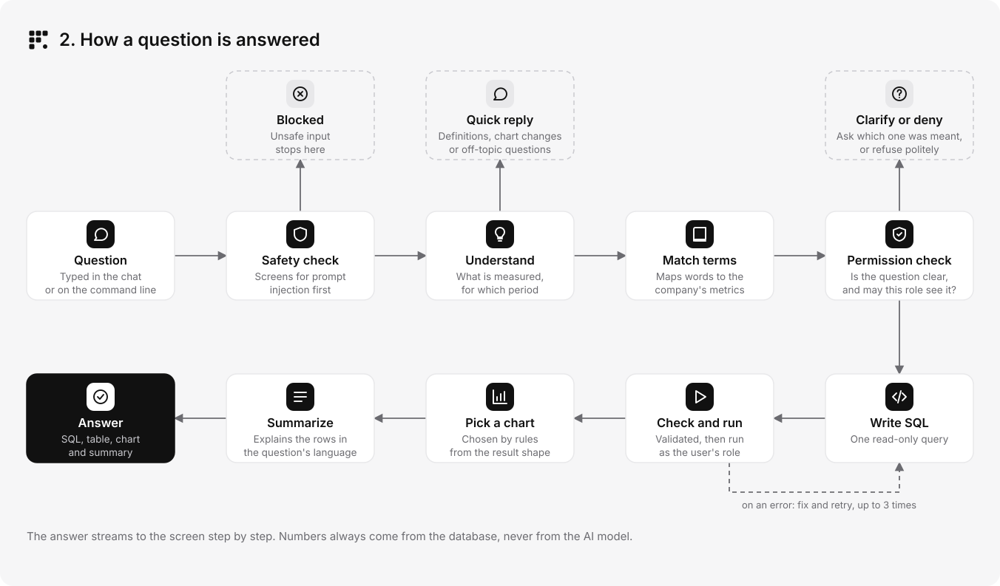
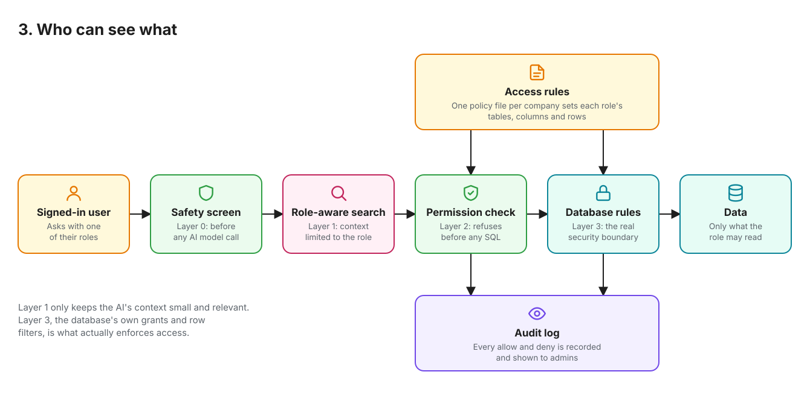
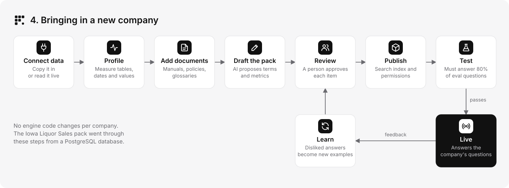
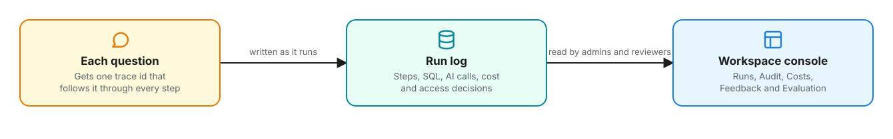

<picture>
  <source media="(prefers-color-scheme: dark)" srcset="docs/brand/banner/fitcher-banner-dark.png">
  
</picture>

Fitcher answers questions about a company's data. You ask in English or Vietnamese, for example "Top 10 best-selling products in Q1 2024 compared with Q1 2025", and it replies with the SQL it ran, a table, a chart and a short summary.

Everything fitcher knows about a company comes from its Domain Pack: a set of reviewed files describing the company's tables, business terms, metrics and who may see what. Swap the pack and the same app answers questions for a different business.

## What you can do with it


| Feature | What it means for a user |
| --- | --- |
| Ask about data | Ask for rankings, trends, comparisons between periods and filtered totals. Relative periods such as "last quarter" use the company's fiscal calendar and your time zone. |
| Hold a conversation | Ask a follow-up and it reuses the previous query. Ask to see the answer as a line chart and it redraws without querying again. Ask what a term means and it answers from the glossary and company documents. |
| Get asked back | When a question is unclear, fitcher asks which meaning you intended and offers the options. |
| See only your data | Each user works under a role. A question about data the role may not read is refused before any SQL is written, and the database enforces the same rules. |
| Stay safe | Every question is screened for prompt injection before it reaches an AI model. For now the screener records its verdict and lets the question through; blocking is switched on once it is accurate enough in both languages. |
| Check the work | Each answer shows the SQL it ran and the steps it took, and admins can open the full trace of any run. |
| Add a new company | fitcher profiles the company's tables, reads its documents and drafts a pack. A reviewer approves each item before it goes live. |
| Measure quality | Each pack has a set of test questions with known answers. A pack goes live only when at least 80% of them return the right result. |

The web app has a chat for everyone and a workspace console for reviewers and admins, in English and Vietnamese, light and dark themes, on desktop and phone.

## How it works



The user talks to the web app, which streams answers from the API. One person uses it without signing in; a team signs in with accounts the API keeps, or through the company's OpenID Connect provider. The API runs the agent: it looks up the company's terms in the search index, sends language tasks to the AI models an admin connected in the app, and runs SQL in ClickHouse as the user's role. Models are called by task (fast replies, simple SQL, harder SQL), any task can use any model of a connected provider, and the pack's test results are shown next to each model. Search uses the provider's embedding model, or a local one when the provider has none. All of these services run together with Docker Compose on one machine.



A question goes through a safety check first. The agent then works out what is being asked, matches the words to the company's metrics, checks that the question is clear and permitted, writes one read-only query, validates and runs it, and picks a chart. If the query fails, the agent fixes it and tries again up to three times; if it still fails, you see the last SQL and the error. Each step shows on screen as it happens, and the numbers in the answer always come from the database, never from the AI model.

The recording below shows one question in the app going through these steps, each lit on the diagram as it runs, with the graph nodes it passed. It then opens the SQL the answer ran, and a follow-up chart change takes the quick-reply path without querying again.




Each company's access rules live in one policy file. Publishing the pack turns it into database roles, column grants, row filters and aggregate-only views, so the database itself stops a role from reading what it should not. Every allow and deny decision goes to the audit log. The role-aware search only keeps the AI's context small and relevant; the database's own grants and row filters are what enforce access.

| Component | Technology |
| --- | --- |
| Web app | Next.js, ECharts, TanStack Table |
| Sign-in | Accounts kept by the API (Argon2id, server-side sessions); optional OpenID Connect provider |
| API and agent | FastAPI with streamed responses, LangGraph, sqlglot |
| AI models | OpenAI, Anthropic, Gemini, a local Ollama model or any OpenAI-compatible endpoint, called in process through the LiteLLM SDK; the provider's embedding model, or a local multilingual one with fastembed |
| Data and run logs | ClickHouse |
| Search index | Qdrant, combining meaning-based and keyword search |
| Data modelling | dbt |
| Domain Packs | YAML checked against JSON Schema |

## Where fitcher is going

fitcher now ships as one image that starts with a single `docker run` (Phase 16); the next phases set up data sources in the application instead of in files and build a first pack automatically: see the [assessment](docs/self-hosted-product-assessment.md) (in Vietnamese), the [decisions](docs/DECISIONS.md) and the [master plan](docs/MASTER_PLAN.md), Phases 13 to 21.

## Quick start

You need Docker. Start fitcher with one command:

```bash
docker run -d --name fitcher -p 127.0.0.1:3000:3000 -v fitcher-data:/data ghcr.io/nguyenminh1301/fitcher
```

Open [localhost:3000](http://localhost:3000) and follow the setup: choose whether only you or a team uses the instance, then connect a model provider and its key, or a model server on this computer reached as `host.docker.internal` (on Linux add `--add-host=host.docker.internal:host-gateway` to the command). Everything is kept in the `fitcher-data` volume. [docs/install.md](docs/install.md) covers the data volume, settings, upgrades, jobs, local models, an external ClickHouse and measured memory use.

To work on fitcher itself with the development datasets, the sample packs and separate services, follow the [development setup](CONTRIBUTING.md#development-setup).

## Using the API

These examples use the [development setup](CONTRIBUTING.md#development-setup), which publishes the API on port 8000. The API streams each answer as server-sent events. In individual mode a request from the local machine needs no sign-in; in team mode, sign in once to get the session cookie and send it with each request. In individual mode a request that changes something must name the page it comes from in `Origin`, which the example sends in both modes:

```bash
curl -s -c fitcher.cookies -H "Content-Type: application/json" -H "Origin: http://127.0.0.1:8000" -d "{\"email\":\"lab.analyst@fitcher.test\",\"password\":\"$DEV_ACCOUNT_PASSWORD\"}" http://127.0.0.1:8000/session
curl -N -b fitcher.cookies -H "Content-Type: application/json" -H "Origin: http://127.0.0.1:8000" -d '{"question":"Top 10 best-selling products in Q1 2024 compared with Q1 2025","timezone":"Asia/Ho_Chi_Minh"}' http://127.0.0.1:8000/ask
```

The stream reports each step as it starts and finishes, then sends the SQL, the result, the chart and the summary. A question that cannot be answered ends with a clarifying question, a refusal, a blocked notice or an error instead. The response names the conversation it started; send that id with the next question to ask a follow-up. Closing the connection stops the run and its database query.

Each user may ask 10 questions a minute by default. The same API manages conversations (list, search, rename, pin, group and delete), records likes and dislikes, and serves the console's admin pages. The [API docs](http://localhost:8000/docs) of a running stack list every endpoint.

## Bringing in a new company



A new company needs its own Domain Pack and nothing else. The Iowa Liquor Sales pack was built this way from a PostgreSQL database.

1. Connect the company's PostgreSQL, MySQL or SQL Server database (SQL Server is copied, never read live), or upload a CSV, Excel or Parquet file, on the console's Sources page or in the setup's Data step: enter the connection, test it, choose the tables and whether to read each live or copy it on a schedule (the [Sources section of the jobs guide](jobs/README.md#connecting-a-source-in-the-interface) gives the read-only user to create). Only ClickHouse holds the credentials. MongoDB and S3 sources are declared in a manifest.
2. Profile the tables to find their columns, date ranges and common values.
3. Upload manuals, policies and glossaries on the console's Documents page.
4. Let the AI draft the pack's terms, metrics and example questions, each with the evidence it used.
5. Review every draft in the console: edit it, test-run it and approve it.
6. Publish the pack and run its test questions.

Later, disliked or failed answers become example proposals. A reviewer corrects and approves them, and the next publish uses them. [packs/](packs/README.md#onboarding-a-company) covers the pack files and each step, and [jobs/](jobs/README.md) lists the commands.

## Quality

Each pack carries test questions with known answers: comparisons between two periods, top N rankings, filters, monthly trends, and questions that should be clarified, refused or declined as off-topic. The evaluation scores each step separately (the type of question, what was extracted, what was found in the search index and whether the result matches) and compares result sets rather than SQL text.

| Pack | Industry | Correct results | Report |
| --- | --- | --- | --- |
| `ecommerce_twin` | E-commerce | 42 of 45 (93%) | [report](docs/eval/spec-building-fixes-report.md) |
| `iowa_liquor` | Spirits wholesale | 30 of 35 (86%) | [report](docs/eval/spec-building-fixes-report.md) |

```bash
docker compose run --rm -v ./build/eval:/app/build/eval api python -m jobs.eval --pack ecommerce_twin --output-dir build/eval
```



Every run is logged in ClickHouse for 90 days: each step, SQL attempt, model call with its estimated cost, and access decision. [docs/tracing.md](docs/tracing.md) shows how to read one trace.

## Development

Use Python 3.13 with uv 0.13.6 and Node 24.21.0 with npm 11. Stop the Compose `api` and `web` services before running them on your machine, because they use the same ports.

```bash
uv sync --project apps/api --frozen
uv run --project apps/api pytest -c apps/api/pyproject.toml
```

```bash
npm --prefix apps/web ci
npm --prefix apps/web run typecheck
npm --prefix apps/web run test
npm --prefix apps/web run build
npm --prefix apps/web run dev
```

Unit tests replace every AI model and search call with a fake, so they need no key. Set `ACTIVE_PACK` before starting the web app; in development, `/dev/components` shows the design system. Commit dependency changes together with `apps/api/uv.lock` or `apps/web/package-lock.json`.

| Folder | Contents |
| --- | --- |
| [apps/api](apps/api) | API, agent and its prompts |
| [apps/web](apps/web) | Chat app and workspace console |
| [packs/](packs/README.md) | Domain Packs and their schemas |
| [dbt/](dbt/README.md) | Models that turn raw tables into the tables the agent reads |
| [jobs/](jobs/README.md) | Commands for loading data, publishing packs, onboarding and evaluation |
| [infra/](infra/README.md) | Service configuration |
| [docs/](docs) | Design notes and evaluation reports |

### Contributing

Branch from `develop` and open a pull request back to it. [CONTRIBUTING.md](CONTRIBUTING.md) describes the branch and commit message format, and [SECURITY.md](SECURITY.md) explains how to report a vulnerability.

## Data and licences

Datasets are never committed; downloads stay in the Git-ignored `data/` folder. FreeEcommerceTwin14M is licensed CC BY-NC 4.0 for non-commercial use. Iowa Liquor Sales 2025 is published by the Iowa Department of Revenue under CC BY 4.0.
