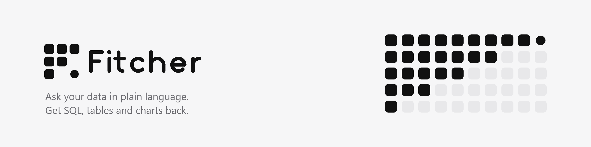
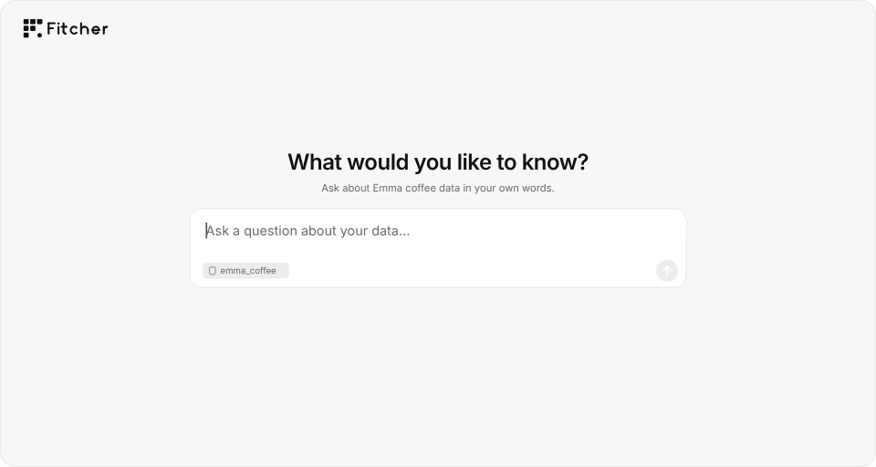

<picture>
  <source media="(prefers-color-scheme: dark)" srcset="docs/brand/banner/fitcher-banner-dark.png">
  
</picture>

Fitcher answers questions about your own data. Connect a database or upload a spreadsheet, ask in English or Vietnamese, for example "Which drink brought in the most money last month?", and it replies with a chart, a table, a short summary and the read-only SQL it ran to get every number.

It runs on your machine with one Docker command, works with the AI provider you choose (or a model on your own computer), and is open source under the MIT License.

<picture>
  <source media="(prefers-color-scheme: dark)" srcset="docs/media/fitcher-ask-dark.gif">
  
</picture>

## What you can do with it

| Feature | What it means for you |
| --- | --- |
| Ask about your data | Ask for rankings, trends, comparisons between periods and filtered totals. Relative periods such as "last quarter" use the source's fiscal calendar and your time zone, and "in total" or "overall" asks about all the data. |
| Hold a conversation | Ask a follow-up and it reuses the previous query. Ask to see the answer as a line chart and it redraws without querying again. Ask what a term means and it answers from what fitcher knows about the source and its documents. |
| Get asked back | When a question is unclear, fitcher asks which meaning you intended and offers options to pick, including "All data" when a period is missing. The option you pick is applied as it is, so the same question is never asked twice. |
| Read only what you chose | Each source answers only from the tables you chose for it. A question about other data is refused before any SQL is written, and every query runs as a database user that can read only those tables. |
| Bring in a source in one click | Connect PostgreSQL, MySQL, MariaDB or SQL Server, or upload a CSV, Excel or Parquet file, choose the tables and make the source ready to answer. fitcher profiles the tables and drafts what it needs to know; drafted items answer at once and show as unreviewed until you approve them. |
| Pick your models | Add OpenAI, Anthropic, Gemini, DeepSeek, OpenRouter, Groq, Mistral, Ollama or any OpenAI-compatible endpoint. fitcher picks a chain of models for each task, free models only or the best ones, and moves to the next model when one fails or hits its limit. |
| Check the work | Each answer shows the SQL it ran and the steps it took, and the console opens the full trace, cost and access decisions of any run. |
| Stay safe | Every question is screened for prompt injection before it reaches an AI model. By default the screener records its verdict, shown on the Query log, and lets the question through; blocking is switched on once it is accurate enough in both languages. |

The chat comes with a console of six areas: Overview, Sources, Documents, Quality, Activity and Settings. Both speak English and Vietnamese, follow light and dark themes, and work on desktop and phone.

## Quick start

You need Docker. Start fitcher with one command:

```bash
docker run -d --name fitcher -p 127.0.0.1:3000:3000 -v fitcher-data:/data ghcr.io/nguyenminh1301/fitcher
```

Open [localhost:3000](http://localhost:3000) and follow the setup: connect a model provider with its key, or a model server on this computer reached as `host.docker.internal` (on Linux add `--add-host=host.docker.internal:host-gateway` to the command), then connect your data. Everything is kept in the `fitcher-data` volume.

[docs/install.md](docs/install.md) covers the first start, settings, local models, memory use and reaching fitcher from other machines; [docs/operations.md](docs/operations.md) backup, restore, upgrades and limits; and [docs/security.md](docs/security.md) the threat model and hardening checklist.

To look around without a model key, the sample-data demo runs the web app with made-up data and no backend:

```bash
docker run -p 127.0.0.1:3000:3000 ghcr.io/nguyenminh1301/fitcher-demo
```

The same demo deploys to Vercel's free plan; [docs/install.md](docs/install.md#public-demo-on-vercel) gives the settings. Its key and password fields are locked, so nobody types a key into a public page.

## How it works


fitcher is one Docker container. The web app is the only open port; behind it the API runs the agent, and an embedded ClickHouse server holds your copied data, the search index and the run logs (or `CLICKHOUSE_URL` points to a ClickHouse server of your own). Settings, sources and the encrypted provider keys live in a small SQLite file next to them in `/data`. The agent sends each language task to the models you connected through an LLM gateway inside the API, which tries each task's models in order. Search uses a local multilingual embedding model by default, so it needs no key.

fitcher is a personal app: there are no accounts, and the API answers only the machine it runs on unless an owner password is set and the browser signs in with it.


A question goes through a safety check first. The agent then works out what is being asked, matches the words to the source's metrics, checks that the question is clear and about this data, writes one read-only query, validates and runs it, and picks a chart. If the query fails, the agent fixes it and tries again up to three times; if it still fails, you see the last SQL and the error. Each step shows on screen as it happens, and the numbers in the answer always come from the database, never from the AI model.


Making a source ready gives its chosen tables to one read-only database user, which every query runs as, so the database itself stops a query from reading anything else. A question about other data is refused before any SQL is written, and every query and refusal goes to the audit log on the Query log page. The knowledge search only keeps the AI's context small and relevant; the database user's grants are what enforce it.

| Component | Technology |
| --- | --- |
| Web app | Next.js, ECharts, TanStack Table |
| API and agent | FastAPI with streamed responses, LangGraph, sqlglot |
| AI models | Any provider you connect, called in process through the LiteLLM SDK; a local multilingual embedding model with fastembed, or a provider's embedding model |
| Data, search and run logs | ClickHouse, embedded or your own; search combines meaning-based and keyword scoring |
| App state | SQLite, with provider keys encrypted by the instance's own key |
| Packaging | One image supervised by s6-overlay |

## Bringing in a new data source


1. Connect a PostgreSQL, MySQL or MariaDB database, or a SQL Server database (copied, never read live), or upload a CSV, Excel or Parquet file, on the Sources page or in the setup's Data step. The [Sources section of the jobs guide](jobs/README.md#connecting-a-source-in-the-interface) gives the read-only database user to create.
2. Choose the tables, and whether to read each one live or copy it on a schedule. Smaller tables are proposed live, larger ones as copies.
3. Make the source ready to answer. fitcher profiles the tables, drafts the source's terms, metrics and example questions with an AI model (the setup says it is a paid call when it is), and builds the search index. The first question can be asked straight away.

Everything after that is optional. On the Quality pages you can approve or edit each drafted item, run the source's test questions, and turn disliked or failed answers into new examples. Manuals, policies and glossaries can be added on the Documents page once documents are turned on.

Behind the interface, what fitcher knows about a source is a Domain Pack: a set of YAML files checked against a JSON Schema. [packs/](packs/README.md#onboarding-a-company) describes the files and [jobs/](jobs/README.md) the commands that build them by hand.

## Using the API

These examples use the [development setup](CONTRIBUTING.md#development-setup), which publishes the API on port 8000. The API streams each answer as server-sent events. A request from the local machine needs no sign-in; a request that changes something must name the page it comes from in `Origin`, which the example sends:

```bash
curl -N -H "Content-Type: application/json" -H "Origin: http://127.0.0.1:8000" -d '{"question":"Top 10 best-selling products in Q1 2024 compared with Q1 2025","timezone":"Asia/Ho_Chi_Minh"}' http://127.0.0.1:8000/ask
```

The stream reports each step as it starts and finishes, then sends the SQL, the result, the chart and the summary. A question that cannot be answered ends with a clarifying question, a refusal, a blocked notice or an error instead. The response names the conversation it started; send that id with the next question to ask a follow-up, and send a clarifying option's id as `clarify_option` to answer with it. Closing the connection stops the run and its database query.

The owner may ask 10 questions a minute by default, and the instance answers 4 at once (1 to 64, set on the Security page or with `PUT /settings/limits`); more wait their turn. The same API manages conversations, sources, models and the console's pages. The [API docs](http://localhost:8000/docs) of a running stack list every endpoint.

## Quality

Each source can carry test questions with known answers: comparisons between two periods, top N rankings, filters, monthly trends, and questions that should be clarified, refused or declined as off-topic. The evaluation scores each step separately (the type of question, what was extracted, what was found in the search index and whether the result matches) and compares result sets rather than SQL text. The Evaluation page shows the share of correct results, and the Models page shows it next to each model; it guides the choice of models and never blocks using one.

Last measured on 2026-11-10 with the development datasets:

| Pack | Industry | Correct results | Report |
| --- | --- | --- | --- |
| `ecommerce_twin` | E-commerce | 42 of 45 (93%) | [report](docs/eval/spec-building-fixes-report.md) |
| `iowa_liquor` | Spirits wholesale | 30 of 35 (86%) | [report](docs/eval/spec-building-fixes-report.md) |

```bash
docker compose run --rm -v ./build/eval:/app/build/eval api python -m jobs.eval --pack ecommerce_twin --output-dir build/eval
```


Every run is logged in ClickHouse for 90 days: each step, SQL attempt, model call with its estimated cost, and access decision. The Activity area reads them on its Runs, Query log and Costs pages, and [docs/tracing.md](docs/tracing.md) shows how to read one trace.

## Status

fitcher 1.0.0 is the first stable release. [CHANGELOG.md](CHANGELOG.md) lists every change since, and the [decisions](docs/DECISIONS.md) and the [master plan](docs/MASTER_PLAN.md) record how the product got here.

## Development

Use Python 3.13 with uv 0.13.6 and Node 24.21.0 with npm 11. Stop the Compose `api` and `web` services before running them on your machine, because they use the same ports.

```bash
uv sync --project apps/api --frozen
uv run --project apps/api pytest -c apps/api/pyproject.toml
```

```bash
npm --prefix apps/web ci
npm --prefix apps/web run typecheck
npm --prefix apps/web run test
npm --prefix apps/web run build
npm --prefix apps/web run dev
```

Unit tests replace every AI model and search call with a fake, so they need no key. In development, `/dev/components` shows the design system. Commit dependency changes together with `apps/api/uv.lock` or `apps/web/package-lock.json`. `python scripts/build_architecture_diagram.py` regenerates the diagrams above and their Excalidraw file.

| Folder | Contents |
| --- | --- |
| [apps/api](apps/api) | API, agent and its prompts |
| [apps/web](apps/web) | Chat app and console |
| [packs/](packs/README.md) | Domain Packs and their schemas |
| [dbt/](dbt/README.md) | Models that turn the development datasets into the tables the agent reads |
| [jobs/](jobs/README.md) | Commands for loading data, building packs, onboarding and evaluation |
| [infra/](infra/README.md) | Image, process supervision and service configuration |
| [docs/](docs) | Decisions, guides and evaluation reports |

### Contributing

Branch from `develop` and open a pull request back to it. [CONTRIBUTING.md](CONTRIBUTING.md) describes the branch and commit message format, and [SECURITY.md](SECURITY.md) explains how to report a vulnerability.

## Data and licences

fitcher is released under the [MIT License](LICENSE). The licence covers this repository's code and documentation, not the datasets or models it works with.

Datasets are never committed; downloads stay in the Git-ignored `data/` folder. FreeEcommerceTwin14M is licensed CC BY-NC 4.0 for non-commercial use. Iowa Liquor Sales 2025 is published by the Iowa Department of Revenue under CC BY 4.0. The café data in the animation above is made up.
